<div align="center">


### A Codex skill for character generation, from first spark to a living, animated cast.

**Describe a character, or hand over a brand, a sketch or finished artwork.** hatch-pet turns it into consistent,<br>
validated animation: desktop pets, custom state libraries, reusable assets, layered scenes, and editable parts.

<br>

<a href="#-the-library-of-moves"></a>
<a href="#-205-ways-to-draw-a-character"></a>
<a href="#-lights-camera-cast"></a>
<a href="#-take-a-character-apart"></a>
<a href="#-who-will-you-hatch"></a>

<br><br>


<sub><i>Meet <b>Pip</b>. Pip was hatched <b>by this skill</b> to star in its own README, and every frame of that parade came out of the pipeline below.</i></sub>

</div>

<br>

## ✦ Everything in the nest

<table>
<tr>
<td width="33%" valign="top" align="center">
<a href="#-the-story-of-a-character"></a>
<b>🥚 Hatch a pet</b><br>
<sub>Idea → canonical portrait → nine animated rows → validated Codex package.</sub>
</td>
<td width="33%" valign="top" align="center">
<a href="#-the-library-of-moves">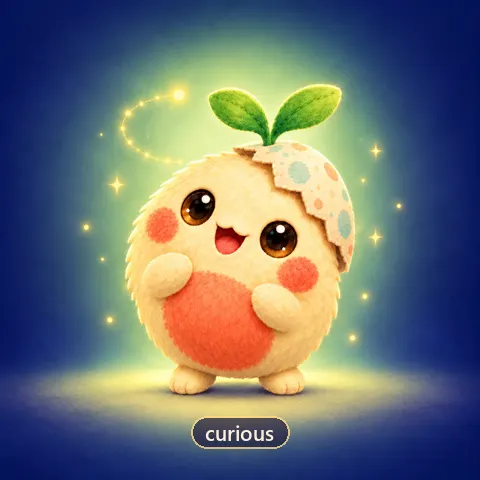</a>
<b>📚 416-state library</b><br>
<sub>Search, pack and compile exactly the moves your character needs.</sub>
</td>
<td width="33%" valign="top" align="center">
<a href="#-205-ways-to-draw-a-character">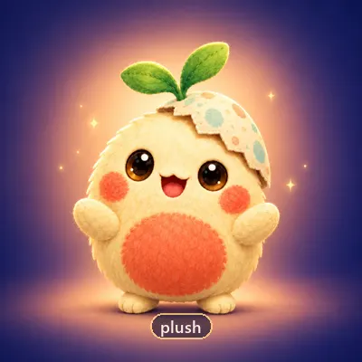</a>
<b>🎨 205 art directions</b><br>
<sub>From 8-bit to stained glass, versioned and hash-frozen per run.</sub>
</td>
</tr>
<tr>
<td width="33%" valign="top" align="center">
<a href="#-lights-camera-cast">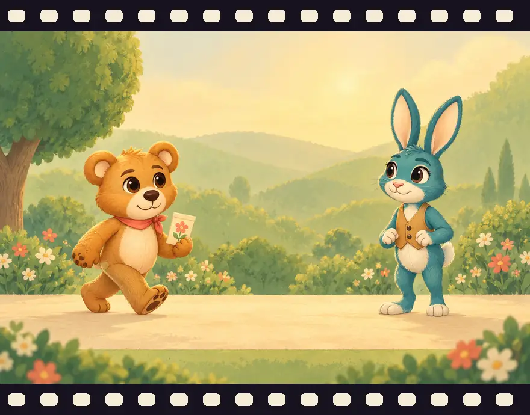</a>
<b>🎬 Cast & scenes</b><br>
<sub>Layered characters, reusable clips, dialogue, props and cameras.</sub>
</td>
<td width="33%" valign="top" align="center">
<a href="#-take-a-character-apart"></a>
<b>🧩 Decomposition</b><br>
<sub>Take a finished image back apart into reviewed, reusable layers.</sub>
</td>
<td width="33%" valign="top" align="center">
<a href="#-who-will-you-hatch"></a>
<b>🌕 Exports everywhere</b><br>
<sub>Game NPCs, stream mascots, tutors, stickers, cursors, print and more.</sub>
</td>
</tr>
</table>

<br>

## 📖 The story of a character

<div align="center">

<sub><i>Every character hatch-pet makes lives through the same five chapters.</i></sub>
</div>

<br>

<table>
<tr>
<td width="46%"></td>
<td width="54%" valign="middle">

#### Chapter I · *The Spark*
A name, a description, reference art and a style become a **durable request**. Brand research keeps its source attribution, and inferred guidance stays separate from (and subordinate to) explicit user constraints.

<sub>`hatch.py prepare` · profile · style · prompts · layout guides</sub>
</td>
</tr>
<tr>
<td width="54%" valign="middle">

#### Chapter II · *The Sketch*
The character gets a **structured identity**: silhouette, palette, props, markings and the asymmetries that must never flip. Every later image is checked against it.

<sub>[sources & identity](references/sources-and-identity.md) · reference roles · identity spec</sub>
</td>
<td width="46%">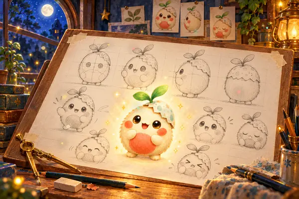</td>
</tr>
<tr>
<td width="46%"></td>
<td width="54%" valign="middle">

#### Chapter III · *The Canonical Portrait*
`$imagegen` paints the **canonical base** (or you import one explicitly), one portrait that every later frame has to match. It's reviewed for identity, transparency and color before any pose is drawn.

<sub>claimed imagegen handoff or explicit import · `base-review`</sub>
</td>
</tr>
<tr>
<td width="54%" valign="middle">

#### Chapter IV · *Learning to Move*
Each state gets an animation strip grounded in the base, the original references and a layout guide. Deterministic scripts extract frames with **one shared viewport and scale**, so a jump really leaves the ground.

<sub>`extract_strip_frames.py` · `inspect_frames.py` · hash-bound provenance</sub>
</td>
<td width="46%"></td>
</tr>
<tr>
<td width="46%">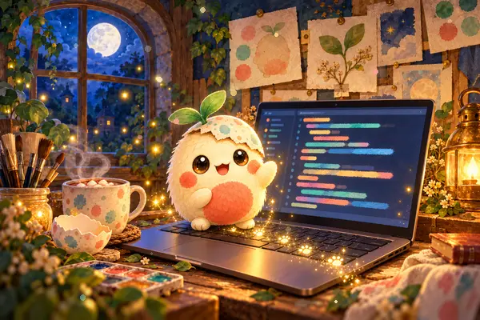</td>
<td width="54%" valign="middle">

#### Chapter V · *Alive*
The atlas is composed, validated and played back at real timing. A **passing visual review** comes before export or packaging, and installation is always a separate, optional step.

<sub>`compose_atlas.py` · `validate_atlas.py` · review desk · export · package</sub>
</td>
</tr>
</table>

<br>

## 🎭 One identity, every angle

<table>
<tr>
<td width="28%" align="center" valign="middle">
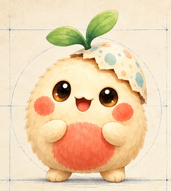
<sub><i>turnaround</i></sub>
</td>
<td width="72%">
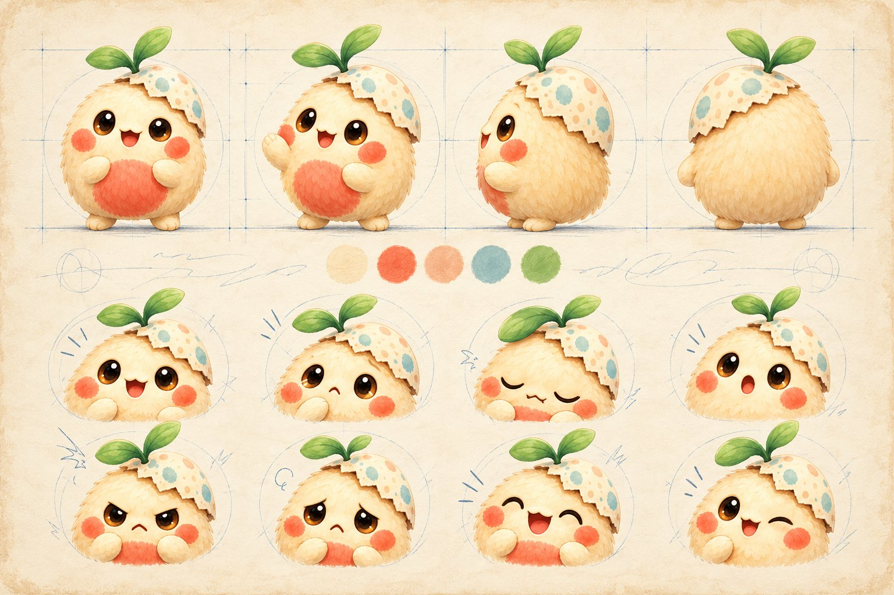
</td>
</tr>
</table>

A character is only a character if it stays **itself** from frame to frame. hatch-pet attaches the canonical portrait, the original references and the structured identity to **every** row it generates. Automated checks measure geometry and consistency, and the visual review must still reject drift even when every number passes.

<br>

## 🎞️ Nine moods, one soul

<div align="center">
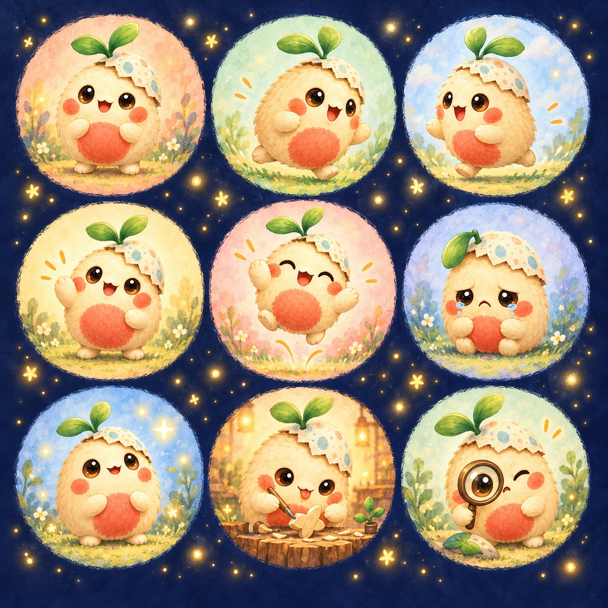
<br><sub><i>The mood board...</i></sub>
<br><br>

<table>
<tr>
<td align="center"><br><code>idle</code><br><sub>breathing, blinking</sub></td>
<td align="center"><br><code>running-right</code><br><sub>off to the right</sub></td>
<td align="center"><br><code>running-left</code><br><sub>and back again</sub></td>
</tr>
<tr>
<td align="center"><br><code>waving</code><br><sub>hello!</sub></td>
<td align="center"><br><code>jumping</code><br><sub>lift, peak, land</sub></td>
<td align="center"><br><code>failed</code><br><sub>it happens</sub></td>
</tr>
<tr>
<td align="center"><br><code>waiting</code><br><sub>needs your input</sub></td>
<td align="center"><br><code>running</code><br><sub>hard at work</sub></td>
<td align="center"><br><code>review</code><br><sub>looking closely</sub></td>
</tr>
</table>
<sub><i>...and the real thing: the nine states Pip actually ships with.</i></sub>
</div>

Codex reads one fixed atlas: **8 columns × 9 rows** of `192×208` cells. Each row is a mood the app can show.

<details>
<summary><b>🧵 See the whole atlas Pip was stitched into</b></summary>
<br>
<div align="center">

</div>

| Row | State | Frames | Timing |
| ---: | --- | ---: | --- |
| 0 | `idle` | 6 | 280 · 110 · 110 · 140 · 140 · 320 ms |
| 1 | `running-right` | 8 | 120 ms, last 220 ms |
| 2 | `running-left` | 8 | 120 ms, last 220 ms |
| 3 | `waving` | 4 | 140 ms, last 280 ms |
| 4 | `jumping` | 5 | 140 ms, last 280 ms |
| 5 | `failed` | 8 | 140 ms, last 240 ms |
| 6 | `waiting` | 6 | 150 ms, last 260 ms |
| 7 | `running` | 6 | 120 ms, last 220 ms |
| 8 | `review` | 6 | 150 ms, last 280 ms |

Unused cells stay perfectly transparent. The final atlas is `1536×1872`.

Pip is the bundled historical sample artwork. Check its atlas geometry locally:

```powershell
python scripts/validate_atlas.py assets/pet/spritesheet.webp
```

That check does not recreate generation provenance or prove current app integration. New runs use the review and packaging gates described in [the workflow](references/workflow.md).
</details>

<br>

## 📚 The Library of Moves

<div align="center">

<sub><i>Pull out only the moves you need, then compile them into one profile.</i></sub>
</div>

<br>

Nine rows are just the beginning. Build custom character profiles from **416 canonical states across 16 categories**, with **408 aliases**, **16 composable packs**, **15 archetype presets**, **9 animation recipes** and **9 event/transition recipes**. Discover states by action, emotion, family or tags, inspect their key poses and generation requirements, then compile only the states you need.

<div align="center">
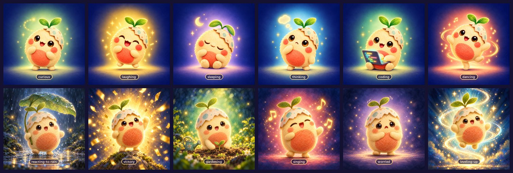
</div>

<table>
<tr>
<td width="50%" valign="top">

**16 categories**

`neutral-idle` · `positive-emotions` · `difficult-emotions` · `cognition` · `locomotion` · `social-gestures` · `pet-daily-life` · `agent-workflows` · `activities-hobbies` · `game-rpg` · `streaming-communication` · `environmental-reactions` · `narrative-cinematic` · `transitions-microexpressions` · `lifecycle-progression` · `accessibility`

</td>
<td width="50%" valign="top">

**15 archetypes**

`generic` · `humanoid` · `quadruped` · `cat` · `dog` · `bird` · `winged` · `fish` · `insect` · `serpentine` · `blob` · `object` · `robot` · `cephalopod` · `shell-creature`

<sub>A cat doesn't get human hands, and a blob doesn't get a tail. Gated actions fail clearly, are filtered, or substitute a disclosed fallback.</sub>

</td>
</tr>
</table>

```bash
python scripts/hatch.py states list
python scripts/hatch.py states search curious
python scripts/hatch.py states packs
python scripts/hatch.py states show running-left
python scripts/hatch.py states compile --selection examples/state-selections/expressive-cat.json --output output/cat-profile.json
```

Compilation produces a strict runtime profile and a separate hash-bound selection manifest, with state/frame counts, raster resource estimates, baseline model-call estimates, dependencies, substitutions and omissions. **It performs no model calls.** The ordinary prepare → acquire/import → extract → validate → review → export workflow consumes that profile, and the manifest accompanies the run, archive and exported assets. **The fixed Codex atlas above remains byte-for-byte unchanged**; additional states are for custom profiles and exported consumers.

<details>
<summary><b>🃏 Archetypes, packs and worked selections</b></summary>
<br>

Use an archetype as a starting point, then match its capabilities to the approved reference. Characters without hands, legs, tails, wings or expressive faces can use explicit alternatives. Required props must also appear in the independently supplied identity contract. Directional variants are generated independently; catalog selection never grants mirroring permission.

Worked selections cover a **cat with 25 expressive states**, a comprehensive coding assistant, a game NPC, an OBS mascot, accessible feedback and a reference-based character studio subset (see [`examples/state-selections`](examples/state-selections)). [Character states](references/character-states.md) documents commands, pack composition, custom definitions, recipes and operational limits. [Validation and acceptance](references/character-state-validation.md) distinguishes definitions, fixture workflows, reviewed production art and external integrations. The [complete state index](state-library/CATALOG.md) lists every definition and alias.

```bash
python scripts/hatch.py states preview curious
python scripts/demonstrate_states.py --all --output-dir output/state-demos
```

The first command reports that artwork is unavailable unless you supply an existing run or export. The second builds explicitly synthetic integration fixtures with inspectable browser previews and review desks. It never presents the fixtures as production character performances.
</details>

<br>

## 🎨 205 ways to draw a character

<table>
<tr>
<td width="40%" align="center" valign="middle"></td>
<td width="60%" valign="middle">

The [versioned style catalog](references/style-catalog.md) provides **205 selectable entries**:

- **195** distinct techniques
- **8** palette and finish treatments
- **2** adaptive selectors (`auto`, `brand-inspired`)
- plus **14** separate thematic modifiers

Every entry includes seven specific generation dimensions, avoidances, use cases, limitations and extraction guidance. The original looks remain available: `pixel` · `plush` · `clay` · `sticker` · `flat-vector` · `3d-toy` · `painterly`.
</td>
</tr>
</table>

<div align="center">
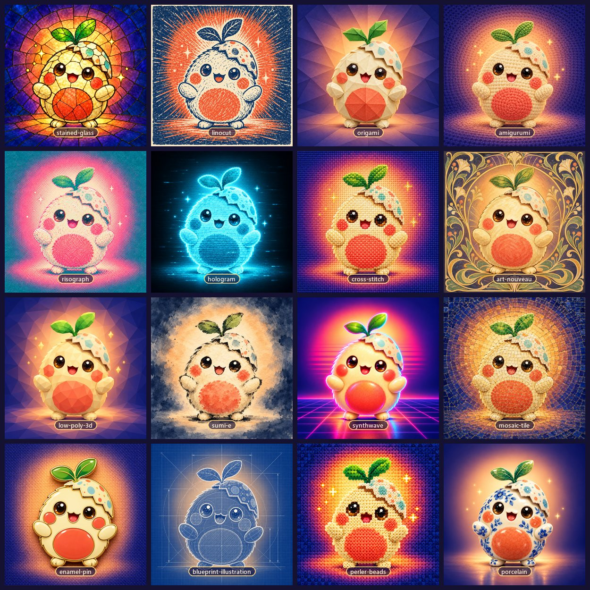
</div>

| 🕹️ Pixel & games | ✏️ Cartoon & vector | 📕 Anime & comics | 🖌️ Painting & drawing | 🪵 Printmaking |
| :---: | :---: | :---: | :---: | :---: |
| `8-bit` `16-bit` `voxel` `isometric-pixel-art` | `rubber-hose-animation` `kawaii` `chibi` `cel-shaded` | `manga-ink` `webtoon` `halftone-comic` `childrens-storybook` | `watercolor` `gouache` `sumi-e` `charcoal` | `linocut` `risograph` `cyanotype` `screen-print` |
| **🧸 3D, sculpture & toys** | **🧶 Textile & fiber** | **✂️ Paper craft** | **💎 Glass & materials** | **📻 Historical & retro** |
| `low-poly-3d` `porcelain` `stop-motion-puppet` `balloon-sculpture` | `amigurumi` `cross-stitch` `needle-felt` `patchwork` | `origami` `paper-quilling` `pop-up-book` `shadow-puppet` | `stained-glass` `enamel-pin` `mosaic-tile` `perler-beads` | `art-nouveau` `art-deco` `synthwave` `y2k` |
| **🔷 Graphic design** | **⚡ Electronic & experimental** | **🪨 Additional techniques** | **🧭 Adaptive** | |
| `bauhaus` `memphis-design` `duotone` `neon-outline` | `hologram` `glitch-art` `blueprint-illustration` `crt-display` | `scratchboard` `encaustic` `marquetry` `sand-art` | `auto` `brand-inspired` | |

```bash
python scripts/hatch.py styles
python scripts/hatch.py styles --search "felt"
python scripts/hatch.py styles --category printmaking --json
python scripts/hatch.py style --style-preset watercolor
python scripts/hatch.py style-modifiers
python scripts/hatch.py prepare --run-dir output/otter-linocut --pet-name Otter --pet-notes "sleepy otter" --style-preset linocut --style-modifier cozy --style-notes "Keep the approved white ear tip."
```

The Codex profile still requires a **compact, readable silhouette** at `192×208`, a **consistent face, palette, materials and props** across nine rows, and clean transparency. The selected style is saved with a version and content hash and retained through retries, repairs, resume, review, export and packaging. Imported art keeps its origin and approved rendering. Explicit identity and user constraints take precedence over preset guidance. Compatibility warnings flag fragile chroma, scaling, GIF and small-cell combinations; subjective art quality still requires visual review. Existing alpha is preserved, and explicit profile extraction settings retain precedence. Custom profiles can explicitly permit detached character details.

The [style validation record](references/style-validation.md) documents the style expansion's 403-test run, independent review, historical compatibility and the distinction between automated fixtures and production artwork. [Combined state and style validation](references/state-style-integration.md) records the subsequent integration check.

<br>

## 🌕 Who will you hatch?

<div align="center">

</div>

<br>

Install the skill into Codex:

```bash
git clone https://github.com/CompleteDotTech/hatch-pet "${CODEX_HOME:-$HOME/.codex}/skills/hatch-pet"
```

Then just ask:

```text
Use $hatch-pet to hatch a sleepy otter barista in a plush style.
```
```text
Use $hatch-pet to make a mascot pet for Acme Robotics in a linocut style.
```
```text
Use $hatch-pet on ./ref/my-cat.png. Clay style, please.
```
```text
Use $hatch-pet to decompose ./ref/dragon.png into editable layers.
```

Choose a new local run and package location. Package creation is separate from installing into Codex:

```text
chosen-package-directory/
├── pet.json
└── spritesheet.webp
```

Packages also retain profile, review, metrics, and export metadata. [Cross-platform commands](references/workflow.md) cover preparation, generation handoffs, resume, repair, review, export, packaging, optional installation, rollback, and cleanup.

### 🪺 Beyond desktop pets

The same character pipeline can feed many other places. See [profiles and exports](references/profiles-and-exports.md).

| Characters for… | Example profile |
| --- | --- |
| 🎮 game NPCs | [`examples/game-npc.json`](examples/game-npc.json) |
| 📺 stream & OBS mascots | [`examples/obs-mascot.json`](examples/obs-mascot.json) |
| 🎓 tutor avatars | [`examples/tutor-avatar.json`](examples/tutor-avatar.json) |
| 💬 stickers & emoji | [`examples/stickers-emoji.json`](examples/stickers-emoji.json) |
| 🛎️ support kiosks | [`examples/support-kiosk.json`](examples/support-kiosk.json) |
| 🎬 storyboards | [`examples/storyboard.json`](examples/storyboard.json) |
| 🌐 web status · UI animation · IoT displays · model evaluation | [`web-status`](examples/web-status.json) · [`ui-animation`](examples/ui-animation.json) · [`iot-display`](examples/iot-display.json) · [`model-evaluation`](examples/model-evaluation.json) |

Ten more [purpose-specific presets and recipes](references/additional-uses.md) cover assembly cards, educational processes, product variants, flipbooks/zoetropes, communication boards, perception stimuli, graphics regression fixtures, animated cursors, protocols and craft grids. They reuse shared print, data, browser, cursor and grid exporters.

The pipeline adds [explicit imports and structured identity](references/sources-and-identity.md), [source-bound extraction annotations and a local review desk](references/extraction-and-review.md), [portable archives and operational budgets](references/portability-and-operations.md), and [bounded state-machine playback](references/playback-and-extensions.md). Exported files, local adapter tests and external integrations are reported separately; these examples do not establish live integrations.

```powershell
python scripts/doctor.py
python scripts/demonstrate.py --all --output-dir output/capability-demos
python -m unittest discover -s tests -v
```

Each demonstration produces real inspectable files, a review desk and `acceptance.json`. All demonstrations are explicitly synthetic fixtures, with no model calls or live installation. [Traceability and validation](references/traceability.md) maps every requirement to evidence, and [the local delivery validation report](references/validation-results.md) has the current regression results, compatibility notes and remaining operating limits.

<br>

## 🎬 Lights, camera, cast

<div align="center">
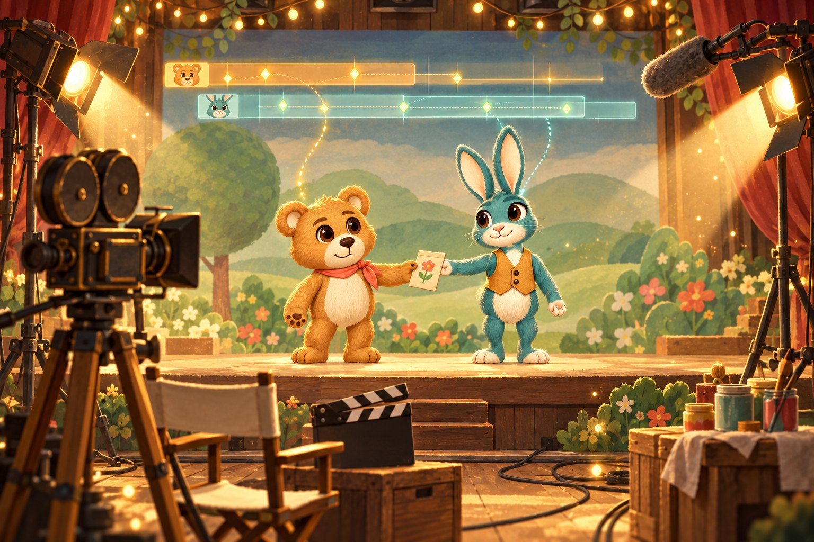
</div>

<br>

Pets become **performers**. The production workflow adds versioned projects and casts, layered character construction, independent performance tracks, reusable motion clips, coordinated props, scenes and cameras, deterministic PNG/PCM rendering, and scoped review history. It builds on the existing imagegen claim, identity, source and repair contracts.

<table>
<tr>
<td width="55%" align="center" valign="top">

<sub><i>The story beats, as an illustrated storyboard</i></sub>
</td>
<td width="45%" align="center" valign="top">

<sub><i>An actual frame from the production pilot</i></sub>
</td>
</tr>
</table>

**Milo and Luma** demonstrate the workflow with original, non-fixture artwork: a **36-second seed exchange** with entrances, walking and stopping, dialogue, reactions, a shared prop handoff, camera cuts and exits; then a **22-second garden scene** reusing the same cast and existing clips. Their 20 authored clips and editable dialogue use one shared character version per identity. The production rig is frontal; the four-view design references do not imply that side or back animation rigs exist.

| 🧸 Cast | 🎞️ Performance | 🎥 Scene | 📦 Handoff |
| --- | --- | --- | --- |
| versioned casts, layered character construction, one shared version per identity | independent performance tracks, reusable motion clips, dialogue, coordinated props | cameras and cuts, deterministic PNG/PCM rendering, scoped review history | local preview with scrubbing; PNG/WAV and layered OpenRaster snapshots for Krita |

Start with the [production recipe](references/production-pilot.md) to restore the exact artwork and original speech, reconstruct the editable project, render both scenes, inspect them, review changes and export the editor handoff. The [demonstration index](examples/production-pilot/README.md) separates source provenance, actual artwork inspection, offline timing, adapter verification and application integration. The [public validation summary](references/production-public-validation.md) records the current results and limitations, and [P01–P15 traceability](references/production-traceability.md) maps the requirements to code, tests and evidence.

> [!IMPORTANT]
> **Current delivery limitation:** the prior author reported local validation of both films and the complete project, but the public source and audio transports remain incomplete and the review-history index is absent. Fresh-clone reconstruction requires the original missing payload; [delivery status](DELIVERY_STATUS.md) records the current repair audit and recovery requirements. The synthetic workflow below uses no model calls or pilot media.

For a complete model-free regression demonstration:

```bash
python scripts/production_regression_demo.py --output-dir output/production-fixture --movie
python scripts/production.py --help
python -m unittest discover -s tests -v
```

The synthetic demonstration covers three scenes and individually drawn full-frame overrides as well as layered acting. Its generated acceptance records are explicitly synthetic. The local preview supports scrubbing, stepping, audio seeking, track visibility and pinned comparisons; exact final timing comes from offline frames and PCM. The supported editor handoff exports PNG/WAV and layered OpenRaster snapshots for Krita. An adapter roundtrip is reported separately from actually running an available Krita installation.

The fixed Codex atlas, millisecond timing, example profiles and package/install behavior remain unchanged. Scene production does not install anything into a live application.

<br>

## 🧩 Take a character apart

<table>
<tr>
<td width="55%" valign="middle"></td>
<td width="45%" valign="middle">

hatch-pet works **both directions** of character creation:

| Direction | Workflow |
| --- | --- |
| ➡️ Forward | description and references → canonical character → poses and animation → assets |
| ⬅️ Reverse | existing character image → foreground analysis and semantic annotations → transparent components → reviewed character definition → reusable generation references |

</td>
</tr>
</table>

```bash
python scripts/hatch.py decompose --source ./character.png --run-dir ./output/decomposed-character
python scripts/hatch.py decompose-review-ui --run-dir ./output/decomposed-character --destination ./output/decomposition-review
python scripts/hatch.py decompose-validate --run-dir ./output/decomposed-character
```

The reverse workflow **preserves the original file** and extracts actual visible source pixels into tightly cropped transparent assets with full-canvas masks, placement coordinates, semantic hierarchy, pivots, confidence, and provenance. It writes `decomposition.json`, compatible `identity.json`, deterministic recomposition and comparison previews, and coverage/overlap diagnostics. PNG, JPEG and WebP inputs keep their native resolution; pixel art keeps its original palette and uses nearest-neighbor previews.

The local review desk supports component isolation, mask correction, split/merge, names and categories, hierarchy, layer order, pivots, attachments, component verdicts and undo. Downloaded changes must be applied through the controller; revisions stay bound to the original source hash. A corrected component can be rebuilt independently while unaffected component approvals remain valid.

> [!NOTE]
> **Semantic labels require evidence.** The offline path identifies foreground geometry and retains every unassigned pixel for review. Supplied masks and semantic labels enable connected body regions to become separate parts, and disconnected details to remain one logical part. An unannotated image is a reviewable starting point; a matching reconstruction does not establish that its anatomy was understood. Optional model assistance follows a documented external annotation/imagegen handoff, and hidden-area reconstruction requires explicit opt-in with separately preserved observed assets.

For a complete, inspectable fixture exercise with no model calls:

```bash
python examples/decomposition/build_fixture.py --case creature --output-dir output/decomposition-creature
```

This creates an authored nonhuman character, extracted layers, a portable export and reload, and an ordinary forward run with an imported base and pending animation work. It never fabricates human approval or generated frames. [Character decomposition](references/character-decomposition.md) contains annotation examples, review/export/reload commands, forward reuse, documented limits, and the separate real-image semantic acceptance protocol.

<br>

## ⚙️ Under the shell

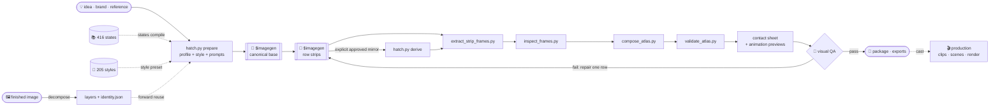

<details>
<summary><b>🧰 Every script and what it does</b></summary>
<br>

| Script | Job |
| --- | --- |
| `scripts/hatch.py` | Locked lifecycle, imagegen/import handoffs, identity, review, archives, budgets, packaging and optional install/rollback |
| `scripts/profile_spec.py` | Validates the single versioned animation contract |
| `scripts/state_catalog.py` | Searches definitions and packs, checks anatomy/props, and compiles bounded custom profiles and recipes |
| `scripts/state_selection.py` | Binds original catalog selection evidence to preparation, review and exports |
| `scripts/prepare_pet_run.py` | Prepares profile-driven prompts, constraints, layout guides and jobs |
| `scripts/style_registry.py` | Validates declarative styles/modifiers, searches metadata and freezes reproducible style contracts |
| `scripts/generate_style_reference.py` | Generates the complete category/ID reference and checks documentation drift |
| `scripts/derive_running_left_from_running_right.py` | Compatibility wrapper for approved controller mirroring |
| `scripts/extract_strip_frames.py` | Conservative slots, shared viewport/scale, masking and hash provenance |
| `scripts/inspect_frames.py` | Exact files/provenance, geometry, temporal and consistency measurements |
| `scripts/compose_atlas.py` | Builds the `1536×1872` PNG + WebP atlas |
| `scripts/validate_atlas.py` | Checks geometry, used and unused cells, and transparency |
| `scripts/make_contact_sheet.py` | Lays out every frame on one sheet for a human-eye check |
| `scripts/render_animation_previews.py` | Renders one GIF per row so motion can be judged |
| `scripts/export_assets.py` | Frames, atlas, stills, GIF/WebP and bounded browser state-machine playback |
| `scripts/asset_exporters.py` | Printable cards, flipbooks, boards, stimuli, Xcursor and craft grids |
| `scripts/demonstrate.py` | Original capability demonstrations plus selected character-state fixture workflows |
| `scripts/demonstrate_states.py` | Five catalog-to-profile import, extraction, review and export demonstrations |
| `scripts/production.py` | Project/cast validation, coverage, generation bindings, versioned imports, scoped reviews, impact, rendering and archive CLI |
| `scripts/production_contracts.py` / `production_performance.py` | Portable cast/clip/scene contracts, independent tracks, motion, dialogue, interaction and continuity evaluation |
| `scripts/production_render.py` / `production_adapter.py` | Deterministic PNG/PCM masters, resumable rendering, local preview and tested PNG/WAV/OpenRaster handoff |
| `scripts/production_demo.py` / `production_regression_demo.py` | Retained production-art pilot and separate model-free regression scenes |
| `scripts/production_sources.py` / `production_bundle.py` | Exact source transport and verified complete-project bundle transport |
| `scripts/character_decomposition.py` | Source-preserving character import, semantic component extraction, deterministic reconstruction and validation |
| `scripts/decomposition_masks.py` / `scripts/decomposition_spec.py` | Bounded source-space masks and strict extensible character contracts |
| `scripts/decomposition_review.py` | Source-bound component corrections, review evidence and revision restoration |
| `scripts/decomposition_package.py` / `scripts/decomposition_reuse.py` | Validated portable layer packages and provenance-tracked forward generation inputs |
</details>

**Design principles**

- 🧠 **Models paint, scripts measure.** Image models never decide atlas geometry. Deterministic code does.
- 🪶 **One claim per generated image** prevents duplicate generation. A reviewer sees all states and actual timed playback.
- 🔒 **Identity evidence.** Every row retains canonical references and structured requirements. Visual review must reject drift even when automated checks pass.
- 🩹 **Repair the row, not the sheet.** A failure regenerates only the smallest scope that broke.
- 🧾 **Fixtures say they're fixtures.** Synthetic demonstrations, adapter roundtrips, reviewed artwork and live integrations are always reported separately.

More detail lives in [`SKILL.md`](SKILL.md), [`references/animation-rows.md`](references/animation-rows.md), [`references/codex-pet-contract.md`](references/codex-pet-contract.md) and [`references/qa-rubric.md`](references/qa-rubric.md).

Run `python -m unittest discover -s tests -v` for the complete local regression suite, including model-free reconstruction checks against retained non-fixture pilot sources. These tests do not call imagegen or confer artwork approval. `python tests/fixture_workflow.py --output-dir C:/work/hatch-fixture-demo --profile examples/web-status.json` creates a clearly labeled legacy demonstration without calling imagegen or installing a pet.

The complete development suite uses `requirements-test.txt` and a local Playwright Chromium binary. Install them if missing with `python -m pip install -r requirements-test.txt` and `python -m playwright install chromium`. The standalone `scripts/doctor.py` reports local capabilities without requiring browser tools.

<sub>🖼️ <b>About the README art:</b> the parade, the nine state GIFs, the contact sheet and the production-pilot frame are real pipeline output. Everything else (the storybook chapters, the style and state cards, the cast, the soundstage, the storyboard and the decomposition illustration) was painted directly with Codex <code>$imagegen</code> as illustration. It is not catalog preview output, decomposition output or reviewed production artwork.</sub>

<br>

<div align="center">


<sub>Imported from <a href="https://github.com/openai/skills">openai/skills</a> · see <a href="LICENSE.txt">LICENSE.txt</a> · art painted by Codex <code>$imagegen</code> · Pip hatched by <code>hatch-pet</code> itself</sub>
</div>
