<div align="center">




**A Codex skill for animated pets, reusable visual assets, layered 2D casts and genuine 3D rigging.**<br>
Start with a concept, brand, sketch, or existing artwork. Generate through the installed imagegen skill, import explicitly, or decompose a character into editable visual components. Validate and visually review, then export or create a local package.

<br>


<sub><i>Meet <b>Pip</b>, who was hatched <b>by this skill</b> to star in its own README. Every frame above came out of the pipeline below.</i></sub>

</div>

<br>

## 🥚 The story of a hatch

<table>
<tr>
<td width="50%" valign="top">

</td>
<td width="50%" valign="top">

### Chapter I · Getting ready
A name, a description, reference art, and a style become a durable request. Brand research retains source attribution and separates inferred guidance from explicit user constraints.

### Chapter II · Imagining the main look
`$imagegen` paints the **canonical base**, a single portrait that every later frame has to match.

### Chapter III · Picturing the poses
Each state gets an animation strip grounded in the base, original references, and a layout guide. Generation can be sequential or delegated when authorized.

### Chapter IV · Hatching
Deterministic scripts preserve motion, validate provenance, compose the atlas, and render review assets. A passing visual review precedes packaging and optional installation.

</td>
</tr>
</table>

## Model3D contract and payload verification

The additive [Model3D foundation](references/model3d-contracts.md) validates strict
requests, sources, assets and lifecycle records, then verifies exact payload hashes
and decodes real geometry through the existing rig importer. It does not generate
models, execute providers, or grant visual approval.

```bash
python scripts/model3d.py capabilities
python scripts/model3d.py validate --file examples/model3d-contracts/robotic.json --root .
```

Use the existing optional rig dependencies below. The [executable example](examples/model3d-contracts/README.md)
reuses unchanged source and animated GLB files; missing or corrupt required content
fails verification. Structural-only checks explicitly leave payloads unverified.

## Real 3D rigs and animation

The optional 3D engine imports real GLB/glTF, OBJ or packed Blender models, preserves original assets, constructs editable skeletons, generates normalized skin weights, and evaluates FK, spatial IK, contacts, expressions and animation channels. It includes humanoid, quadruped, six-legged winged, robotic and extensible custom templates; manual corrections, semantic retargeting, local review, animated GLB export and independently reopened Blender files.

```bash
python -m pip install "Pillow>=10.1" -r requirements-rig.txt
python scripts/hatch.py rig doctor
python scripts/rig.py import --model input/character.glb --run-dir output/character
python scripts/rig.py auto --run-dir output/character --template humanoid
python scripts/rig.py weights --run-dir output/character --method auto
python scripts/rig.py validate --run-dir output/character
python scripts/rig.py review-ui --run-dir output/character --destination output/review
```

Read the [complete 3D guide](references/3d-rigging.md) for fitting uncertainty, corrections, animation authoring, APIs, state mapping, render/export commands and tool setup. Inspect the [acceptance report](references/3d-rigging-acceptance.md) and [retained demonstration evidence](examples/rig-3d/acceptance.json). The three character demonstrations each contain six real motions; a mechanical fixture and two proportion-changing retargets add coverage. Their source meshes are labelled procedural engineering fixtures, with production-art approval pending.

The 3D contracts are additive. Existing Codex atlas geometry/timing, 2D profiles/playback, decomposition and the 416-state catalog retain their original contracts. Selected actual clips map to catalog definitions; missing anatomy or animation remains explicit. Blender, WebGL and the optional 3D Python packages are unnecessary for ordinary 2D use.

The [physics integration audit](references/physics-3d-audit.md) records current subsystem ownership, coordinate and timing decisions, and the executed compatibility baseline for future simulation work. No physics solver is implemented by that audit.

<div align="center">


</div>

<br>

## 🎞️ Nine states, one personality

Codex reads one fixed atlas: **8 columns × 9 rows** of `192×208` cells. Each row is a mood the app can show.

<div align="center">
<table>
<tr>
<td align="center"><br><code>idle</code><br><sub>breathing, blinking</sub></td>
<td align="center"><br><code>running-right</code><br><sub>off to the right</sub></td>
<td align="center"><br><code>running-left</code><br><sub>and back again</sub></td>
</tr>
<tr>
<td align="center"><br><code>waving</code><br><sub>hello!</sub></td>
<td align="center"><br><code>jumping</code><br><sub>lift, peak, land</sub></td>
<td align="center"><br><code>failed</code><br><sub>it happens</sub></td>
</tr>
<tr>
<td align="center"><br><code>waiting</code><br><sub>needs your input</sub></td>
<td align="center"><br><code>running</code><br><sub>hard at work</sub></td>
<td align="center"><br><code>review</code><br><sub>looking closely</sub></td>
</tr>
</table>
</div>

<details>
<summary><b>🧵 See the whole atlas Pip was stitched into</b></summary>
<br>
<div align="center">

</div>

| Row | State | Frames | Timing |
| ---: | --- | ---: | --- |
| 0 | `idle` | 6 | 280 · 110 · 110 · 140 · 140 · 320 ms |
| 1 | `running-right` | 8 | 120 ms, last 220 ms |
| 2 | `running-left` | 8 | 120 ms, last 220 ms |
| 3 | `waving` | 4 | 140 ms, last 280 ms |
| 4 | `jumping` | 5 | 140 ms, last 280 ms |
| 5 | `failed` | 8 | 140 ms, last 240 ms |
| 6 | `waiting` | 6 | 150 ms, last 260 ms |
| 7 | `running` | 6 | 120 ms, last 220 ms |
| 8 | `review` | 6 | 150 ms, last 280 ms |

Unused cells stay perfectly transparent. The final atlas is `1536×1872`.
</details>

### 🐣 Inspect Pip

Pip is the bundled historical sample artwork. Check its atlas geometry locally:

```powershell
python scripts/validate_atlas.py assets/pet/spritesheet.webp
```

That check does not recreate generation provenance or prove current app integration. New runs use the review and packaging gates described in [the workflow](references/workflow.md).

## Character state library

Build custom character profiles from **416 canonical states across 16 categories**, with 408 aliases, sixteen composable packs, fifteen archetype presets, nine animation recipes and nine event/transition recipes. Discover states by action, emotion, family or tags, inspect their key poses and generation requirements, then compile only the states you need. The fixed Codex atlas above remains byte-for-byte unchanged; additional states are for custom profiles and exported consumers.

```bash
python scripts/hatch.py states list
python scripts/hatch.py states search curious
python scripts/hatch.py states packs
python scripts/hatch.py states show running-left
python scripts/hatch.py states compile --selection examples/state-selections/expressive-cat.json --output output/cat-profile.json
```

Compilation produces a strict runtime profile and a separate hash-bound selection manifest, with state/frame counts, raster resource estimates, baseline model-call estimates, dependencies, substitutions and omissions. It performs no model calls. The ordinary prepare → acquire/import → extract → validate → review → export workflow consumes that profile. The manifest accompanies the run, archive and exported assets.

Use an archetype as a starting point, then match its capabilities to the approved reference. Characters without hands, legs, tails, wings or expressive faces can use explicit alternatives. Required props must also appear in the independently supplied identity contract. Directional variants are generated independently; catalog selection never grants mirroring permission.

Worked selections cover a **cat with 25 expressive states**, a comprehensive coding assistant, a game NPC, an OBS mascot, accessible feedback and a reference-based character studio subset. [Character states](references/character-states.md) documents commands, pack composition, custom definitions, recipes and operational limits. [Validation and acceptance](references/character-state-validation.md) distinguishes definitions, fixture workflows, reviewed production art and external integrations.

```bash
python scripts/hatch.py states preview curious
python scripts/demonstrate_states.py --all --output-dir output/state-demos
```

The first command reports that artwork is unavailable unless you supply an existing run or export. The second builds explicitly synthetic integration fixtures with inspectable browser previews and review desks. It never presents the fixtures as production character performances.

<br>

## 🎨 Any style, as long as it's pet-safe

<div align="center">


The original looks remain available: `pixel` · `plush` · `clay` · `sticker` · `flat-vector` · `3d-toy` · `painterly` · `brand-inspired` · `auto`.
</div>

The [versioned style catalog](references/style-catalog.md) provides **205 selectable entries: 195 distinct techniques, 8 palette/finish treatments and 2 adaptive selectors**, plus **14 separate thematic modifiers**. Explore pixel and game art, cartoons, comics, painting, printmaking, sculpture, textiles, paper craft, glass and unusual materials, historical design, contemporary graphics and electronic techniques. Every entry includes seven specific generation dimensions, avoidances, use cases, limitations and extraction guidance. The illustration above is the retained historical seven-look artwork; it is not a preview of the expanded catalog.

```bash
python scripts/hatch.py styles
python scripts/hatch.py styles --search "felt"
python scripts/hatch.py styles --category printmaking --json
python scripts/hatch.py style --style-preset watercolor
python scripts/hatch.py style-modifiers
python scripts/hatch.py prepare --run-dir output/otter-linocut --pet-name Otter --pet-notes "sleepy otter" --style-preset linocut --style-modifier cozy --style-notes "Keep the approved white ear tip."
```

The Codex profile still requires a **compact, readable silhouette** at `192×208`, a **consistent face, palette, materials and props** across nine rows, and clean transparency. The selected style is saved with a version and content hash and retained through retries, repairs, resume, review, export and packaging. Imported art keeps its origin and approved rendering. Explicit identity and user constraints take precedence over preset guidance. Compatibility warnings flag fragile chroma, scaling, GIF and small-cell combinations; subjective art quality still requires visual review. Existing alpha is preserved, and explicit profile extraction settings retain precedence. Custom profiles can explicitly permit detached character details.

The [style validation record](references/style-validation.md) documents the style expansion's 403-test run, independent review, historical compatibility and the distinction between automated fixtures and production artwork. [Combined state and style validation](references/state-style-integration.md) records the subsequent integration check.

<br>

## 🚀 Hatch your own

This repository is **Creative Studio**. The installed skill remains **`hatch-pet`**
for compatibility with existing invocations, profiles and local installations.
The repository name does not imply that the planned Director, general 3D scene
editor or physics production programs are complete.

Install the skill into Codex:

```bash
git clone https://github.com/CompleteTech-Skills/creative-studio "${CODEX_HOME:-$HOME/.codex}/skills/hatch-pet"
```

Then just ask:

```text
Use $hatch-pet to hatch a sleepy otter barista in a plush style.
```
```text
Use $hatch-pet to make a mascot pet for Acme Robotics.
```
```text
Use $hatch-pet on ./ref/my-cat.png. Clay style, please.
```

Choose a new local run and package location. Package creation is separate from installing into Codex:

```text
chosen-package-directory/
├── pet.json
└── spritesheet.webp
```

Packages also retain profile, review, metrics, and export metadata. [Cross-platform commands](references/workflow.md) cover preparation, generation handoffs, resume, repair, review, export, packaging, optional installation, rollback, and cleanup.

For other applications, see [profiles and exports](references/profiles-and-exports.md). The ten existing character examples remain supported. Ten new [purpose-specific presets and recipes](references/additional-uses.md) cover assembly cards, educational processes, product variants, flipbooks/zoetropes, communication boards, perception stimuli, graphics regression fixtures, animated cursors, protocols and craft grids. They reuse shared print, data, browser, cursor and grid exporters.

The revised pipeline adds [explicit imports and structured identity](references/sources-and-identity.md), [source-bound extraction annotations and a local review desk](references/extraction-and-review.md), [portable archives and operational budgets](references/portability-and-operations.md), and [bounded state-machine playback](references/playback-and-extensions.md). Exported files, local adapter tests and external integrations are reported separately; these examples do not establish live integrations.

```powershell
python scripts/doctor.py
python scripts/demonstrate.py --all --output-dir output/capability-demos
python -m unittest discover -s tests -v
```

Each demonstration produces real inspectable files, a review desk and `acceptance.json`. All demonstrations are explicitly synthetic fixtures, with no model calls or live installation. [Traceability and validation](references/traceability.md) maps every requirement to evidence.

See [the local delivery validation report](references/validation-results.md) for the current regression results, compatibility notes and remaining operating limits.

<br>

## 🎬 Reuse a cast across scenes


The production workflow adds versioned projects and casts, layered character construction, independent performance tracks, reusable motion clips, coordinated props, scenes and cameras, deterministic PNG/PCM rendering, and scoped review history. It builds on the existing imagegen claim, identity, source and repair contracts.

**Milo and Luma** demonstrate the workflow with original, non-fixture artwork: a **36-second seed exchange** with entrances, walking and stopping, dialogue, reactions, a shared prop handoff, camera cuts and exits; then a **22-second garden scene** reusing the same cast and existing clips. Their 20 authored clips and editable dialogue use one shared character version per identity. The production rig is frontal; the four-view design references do not imply that side or back animation rigs exist.

Start with the [production recipe](references/production-pilot.md) to restore the exact artwork and original speech, reconstruct the editable project, render both scenes, inspect them, review changes and export the editor handoff. The [demonstration index](examples/production-pilot/README.md) separates source provenance, actual artwork inspection, offline timing, adapter verification and application integration. [Public validation summary](references/production-public-validation.md) records the current results and limitations; [P01–P15 traceability](references/production-traceability.md) maps the requirements to code, tests and evidence.

The delivery contains the original artwork, original speech, the unmodified 20-record assistant review history, and its hash-verified supporting inspection images. [Delivery status](DELIVERY_STATUS.md) records recovery, publication and validation separately. The five source transports are ordinary Git files; Git LFS, private storage and a model account are unnecessary for reconstruction.

Watch the public [36-second seed-exchange MP4](examples/production-pilot/media/seed-exchange.mp4) and [22-second garden-promise MP4](examples/production-pilot/media/garden-promise.mp4), or inspect their [storyboards and layered drawings](examples/production-pilot/README.md#completed-films-and-inspectable-outputs). These are actual verified public-CI renders of the retained production artwork.

From a fresh clone, use Python 3.12 and a **new** destination:

```bash
python -m pip install -r requirements-delivery.txt
python scripts/production_sources.py verify-delivery
python scripts/production_sources.py restore-pilot --destination output/milo-luma
python scripts/production.py validate --project output/milo-luma
python scripts/production.py render --project output/milo-luma --scene seed-exchange --destination output/milo-luma/renders/seed-exchange
python scripts/production.py render --project output/milo-luma --scene garden-promise --destination output/milo-luma/renders/garden-promise
python -m http.server 8765 --bind 127.0.0.1 --directory output/milo-luma
```

Open `/renders/seed-exchange/preview.html` or `/renders/garden-promise/preview.html` on the local server. Add `--video` to a render command when FFmpeg and ffprobe are installed. Original acquisition records and speech bytes are preserved; missing originals fail instead of triggering new synthesis. Historical assistant decisions are not human signoff or automatic acceptance of a changed renderer.

The complete delivery gate runs every regression, restores a portable archive, renders all 696 frames and both PCM masters, verifies unchanged-frame reuse, and exports both editor handoffs:

```bash
python -m playwright install --with-deps chromium
python scripts/verify_public_delivery.py --destination delivery-verification --tests --render --video
```

This gate requires Git, Node, Chromium, FFmpeg and ffprobe. Native Krita is optional and reported separately. The [validation reference](references/production-public-validation.md) explains strict skip accounting and retained reports. Windows, Linux and macOS use the same commands and pinned dependencies.

For a complete model-free regression demonstration:

```bash
python scripts/production_regression_demo.py --output-dir output/production-fixture --movie
python scripts/production.py --help
python -m unittest discover -s tests -v
```

The synthetic demonstration covers three scenes and individually drawn full-frame overrides as well as layered acting. Its generated acceptance records are explicitly synthetic. The local preview supports scrubbing, stepping, audio seeking, track visibility and pinned comparisons; exact final timing comes from offline frames and PCM. The supported editor handoff exports PNG/WAV and layered OpenRaster snapshots for Krita. An adapter roundtrip is reported separately from actually running an available Krita installation.

The fixed Codex atlas, millisecond timing, example profiles and package/install behavior remain unchanged. Scene production does not install anything into a live application.

<br>

## Character decomposition: from a finished image back to editable layers

Hatch Pet supports both directions of character creation:

| Direction | Workflow |
| --- | --- |
| Forward | Description and references → canonical character → poses and animation → assets |
| Reverse | Existing character image → foreground analysis and semantic annotations → transparent components → reviewed character definition → reusable generation references |

```bash
python scripts/hatch.py decompose --source ./character.png --run-dir ./output/decomposed-character
python scripts/hatch.py decompose-review-ui --run-dir ./output/decomposed-character --destination ./output/decomposition-review
python scripts/hatch.py decompose-validate --run-dir ./output/decomposed-character
```

The reverse workflow preserves the original file and extracts actual visible source pixels into tightly cropped transparent assets with full-canvas masks, placement coordinates, semantic hierarchy, pivots, confidence, and provenance. It writes `decomposition.json`, compatible `identity.json`, deterministic recomposition and comparison previews, and coverage/overlap diagnostics. PNG, JPEG and WebP inputs keep their native resolution; pixel art keeps its original palette and uses nearest-neighbor previews.

The local review desk supports component isolation, mask correction, split/merge, names and categories, hierarchy, layer order, pivots, attachments, component verdicts and undo. Downloaded changes must be applied through the controller; revisions stay bound to the original source hash. A corrected component can be rebuilt independently while unaffected component approvals remain valid.

**Semantic labels require evidence.** The offline path identifies foreground geometry and retains every unassigned pixel for review. Supplied masks and semantic labels enable connected body regions to become separate parts, and disconnected details to remain one logical part. An unannotated image is a reviewable starting point; a matching reconstruction does not establish that its anatomy was understood. Optional model assistance follows a documented external annotation/imagegen handoff, and hidden-area reconstruction requires explicit opt-in with separately preserved observed assets.

For a complete, inspectable fixture exercise with no model calls:

```bash
python examples/decomposition/build_fixture.py --case creature --output-dir output/decomposition-creature
```

This creates an authored nonhuman character, extracted layers, a portable export and reload, and an ordinary forward run with an imported base and pending animation work. It never fabricates human approval or generated frames. [Character decomposition](references/character-decomposition.md) contains annotation examples, review/export/reload commands, forward reuse, documented limits, and the separate real-image semantic acceptance protocol.

<br>

## ⚙️ Under the shell

```mermaid
flowchart LR
    A([💡 idea · brand · reference]) --> B[hatch.py prepare<br/>profile + prompts + layout guides]
    B --> C[[🎨 $imagegen<br/>canonical base]]
    C --> D[[🎨 $imagegen ×9<br/>row strips]]
    D -->|explicit approved mirror| E[hatch.py derive]
    D --> F[extract_strip_frames.py]
    E --> F
    F --> G[inspect_frames.py]
    G --> H[compose_atlas.py]
    H --> I[validate_atlas.py]
    I --> J[make_contact_sheet.py<br/>render_animation_previews.py]
    J --> K{👀 visual QA}
    K -->|fail: repair one row| D
    K -->|pass| L([🐣 pet.json + spritesheet.webp])
```



| Script | Job |
| --- | --- |
| `scripts/hatch.py` | Locked lifecycle, imagegen/import handoffs, identity, review, archives, budgets, packaging and optional install/rollback |
| `scripts/profile_spec.py` | Validates the single versioned animation contract |
| `scripts/state_catalog.py` | Searches definitions and packs, checks anatomy/props, and compiles bounded custom profiles and recipes |
| `scripts/state_selection.py` | Binds original catalog selection evidence to preparation, review and exports |
| `scripts/prepare_pet_run.py` | Prepares profile-driven prompts, constraints, layout guides and jobs |
| `scripts/style_registry.py` | Validates declarative styles/modifiers, searches metadata and freezes reproducible style contracts |
| `scripts/generate_style_reference.py` | Generates the complete category/ID reference and checks documentation drift |
| `scripts/derive_running_left_from_running_right.py` | Compatibility wrapper for approved controller mirroring |
| `scripts/extract_strip_frames.py` | Conservative slots, shared viewport/scale, masking and hash provenance |
| `scripts/inspect_frames.py` | Exact files/provenance, geometry, temporal and consistency measurements |
| `scripts/compose_atlas.py` | Builds the `1536×1872` PNG + WebP atlas |
| `scripts/validate_atlas.py` | Checks geometry, used and unused cells, and transparency |
| `scripts/make_contact_sheet.py` | Lays out every frame on one sheet for a human-eye check |
| `scripts/render_animation_previews.py` | Renders one GIF per row so motion can be judged |
| `scripts/export_assets.py` | Frames, atlas, stills, GIF/WebP and bounded browser state-machine playback |
| `scripts/asset_exporters.py` | Printable cards, flipbooks, boards, stimuli, Xcursor and craft grids |
| `scripts/demonstrate.py` | Original capability demonstrations plus selected character-state fixture workflows |
| `scripts/demonstrate_states.py` | Five catalog-to-profile import, extraction, review and export demonstrations |
| `scripts/production.py` | Project/cast validation, coverage, generation bindings, versioned imports, scoped reviews, impact, rendering and archive CLI |
| `scripts/production_contracts.py` / `production_performance.py` | Portable cast/clip/scene contracts, independent tracks, motion, dialogue, interaction and continuity evaluation |
| `scripts/production_render.py` / `production_adapter.py` | Deterministic PNG/PCM masters, resumable rendering, local preview and tested PNG/WAV/OpenRaster handoff |
| `scripts/production_demo.py` / `production_regression_demo.py` | Retained production-art pilot and separate model-free regression scenes |
| `scripts/production_sources.py` / `production_bundle.py` | Exact source transport and verified complete-project bundle transport |
| `scripts/character_decomposition.py` | Source-preserving character import, semantic component extraction, deterministic reconstruction and validation |
| `scripts/decomposition_masks.py` / `scripts/decomposition_spec.py` | Bounded source-space masks and strict extensible character contracts |
| `scripts/decomposition_review.py` | Source-bound component corrections, review evidence and revision restoration |
| `scripts/decomposition_package.py` / `scripts/decomposition_reuse.py` | Validated portable layer packages and provenance-tracked forward generation inputs |

**Design principles**

- 🧠 **Models paint, scripts measure.** Image models never decide atlas geometry. Deterministic code does.
- 🪶 **One claim per generated image** prevents duplicate generation. A reviewer sees all states and actual timed playback.
- 🔒 **Identity evidence.** Every row retains canonical references and structured requirements. Visual review must reject drift even when automated checks pass.
- 🩹 **Repair the row, not the sheet.** A failure regenerates only the smallest scope that broke.

More detail lives in [`SKILL.md`](SKILL.md), [`references/animation-rows.md`](references/animation-rows.md), [`references/codex-pet-contract.md`](references/codex-pet-contract.md) and [`references/qa-rubric.md`](references/qa-rubric.md).

Run `python -m unittest discover -s tests -v` for the complete local regression suite, including model-free reconstruction checks against retained non-fixture pilot sources. These tests do not call imagegen or confer artwork approval. `python tests/fixture_workflow.py --output-dir C:/work/hatch-fixture-demo --profile examples/web-status.json` creates a clearly labeled legacy demonstration without calling imagegen or installing a pet.

For the existing 2D suite, use a separate environment with `requirements-delivery.txt` and a local Playwright Chromium binary, then run `python scripts/test_rig_gate.py compatibility`. For complete discovery including the optional 3D tests, install `requirements-test.txt` and `requirements-rig-test.txt` in another environment and run `python -m unittest discover -s tests -v`. These environments have different pinned dependency versions; do not combine the delivery and rig requirement files. Install Chromium with `python -m playwright install chromium`. Blender, the Khronos validator and opt-in browser checks have separate setup and release gates in [the 3D guide](references/3d-rigging.md); an optional-tool skip is not an interoperability pass. The standalone `scripts/doctor.py` reports local capabilities without requiring browser tools.

See [contributor and triage guidance](CONTRIBUTING.md) for evidence terminology,
label governance and the separation between local tests, CI and production review.

### Director engineering baseline

The [Director baseline audit](references/director-baseline.md) records the exact starting revision, source-delivery and regression evidence, repository coordination, and legacy compatibility boundaries for issue #23. Its [requirement and interface map](references/director-requirements-map.md) identifies existing subsystem owners and the remaining Director work. Audit completion does not imply that Director planning, full 3D scene production, or its silent-video demonstrations are implemented.

<br>

<div align="center">


<sub>Imported from <a href="https://github.com/openai/skills">openai/skills</a> · see <a href="LICENSE.txt">LICENSE.txt</a> · art painted by Codex <code>$imagegen</code> · Pip hatched by <code>hatch-pet</code> itself</sub>
</div>
